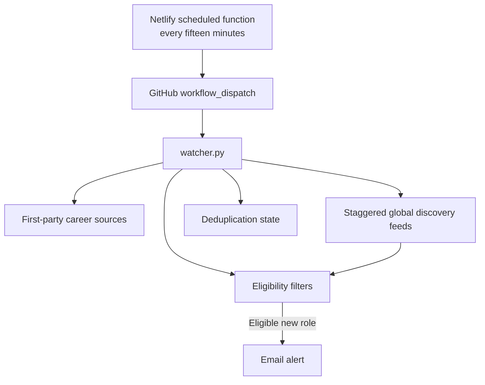

# AI-Cybersecurity Job Alert Agent

An open, reusable fifteen-minute job monitor for AI-cybersecurity opportunities. It checks first-party career sources and staggered global discovery feeds, applies configurable eligibility rules, deduplicates previously seen postings and emails only genuinely new matches.

This project is shared as a public-good template for job seekers. Fork it, replace the example preferences with your own and keep all credentials in GitHub Secrets or Netlify environment variables—never in the repository.

## Schedule

Netlify dispatches a scan every 15 minutes, at `02`, `17`, `32` and `47` minutes past the hour. GitHub records these dispatches as **Manually triggered**. The first successful check establishes a quiet baseline. Later scans send email when a role passes the configured filters and qualifies as new or newly eligible.

## Example decisions

These examples use fictional employers and listings.

| Listing | Result | Reason |
| --- | --- | --- |
| Security Product Marketing Manager at Example Security · full-time IC · Remote worldwide | Email on a later scan if the role is new and meets the configured score | The title and location pass the example filters. |
| Security Product Marketing Manager at Example Security · Remote US only | No email under the example rules | The posting restricts remote work to the US. |

Example subject for the eligible listing, with an illustrative score.

```text
JOB ALERT: 88/100 Example Security — Security Product Marketing Manager
```

## What it monitors

The default configuration focuses on individual-contributor roles such as:

- Technical Product Marketing Manager
- Security or Product Marketing Manager
- Technical or Security Marketing Manager
- Solutions or Developer Marketing
- Product or Technical Communications
- Technical Content Lead or Writer
- Developer Advocate or Developer Relations
- Content Strategy or Marketing
- Founder Brand or Social Media

Paid-media, field-marketing, demand-generation, SEO, sales, engineering and people-management roles are penalized or rejected by the example rules.

## Example company watchlist

The included watchlist is only a starting point. Edit [`config.json`](config.json) for your own market, role families, geography and compensation requirements.

| Focus | Companies |
|---|---|
| AI SOC and autonomous security operations | [Arcanna.ai](https://arcanna.ai/), [Dropzone AI](https://www.dropzone.ai/), [Prophet Security](https://www.prophetsecurity.ai/), [Simbian](https://simbian.ai/) |
| AI, data and agent security | [Harmonic Security](https://www.harmonic.security/), [Sola Security](https://sola.security/), [Noma Security](https://noma.security/), [Zenity](https://zenity.io/), [Pillar Security](https://www.pillar.security/), [Straiker](https://www.straiker.ai/), [Enkrypt AI](https://www.enkryptai.com/), [WitnessAI](https://witness.ai/), [Keycard](https://www.keycard.ai/) |
| AI-native threat detection and offensive security | [Abnormal Security](https://abnormal.ai/), [SentinelOne](https://www.sentinelone.com/), [CloudSEK](https://www.cloudsek.com/), [HiddenLayer](https://www.hiddenlayer.com/), [XBOW](https://xbow.com/), [Cracken](https://jobs.ashbyhq.com/crackenagi) |

The collector supports first-party career pages and public ATS boards such as [Ashby](https://www.ashbyhq.com/), [Greenhouse](https://www.greenhouse.com/) and [Lever](https://www.lever.co/). Do not add scraped aggregators or private endpoints.

## Global discovery markets

The fixed company watchlist remains the fastest path. A second, best-effort layer checks public APIs and RSS feeds to find matching roles at companies that are not yet on that list:

| Market | Interface | Cadence |
|---|---|---:|
| [ZeroDay Careers](https://zeroday.careers/jobs) | RSS | 30 minutes |
| [Remote First Jobs](https://remotefirstjobs.com/) | Cybersecurity, AI and marketing RSS feeds | 30 minutes |
| [Startup.jobs](https://startup.jobs/) | Remote RSS | 60 minutes |
| [Himalayas](https://himalayas.app/jobs) | RSS | 60 minutes |
| [Remote OK](https://remoteok.com/) | Public JSON API | 60 minutes |
| [We Work Remotely](https://weworkremotely.com/) | Product and sales/marketing RSS feeds | 60 minutes |
| [Jobicy](https://jobicy.com/) | Public JSON API | 60 minutes |
| [Remote Gig](https://remotegig.in/alerts) | Public Atom feed | 60 minutes |
| [YC startup jobs via Hacker News](https://news.ycombinator.com/jobs) | Official Hacker News Job Stories API, latest 12 posts | 60 minutes |
| [Arbeitnow](https://www.arbeitnow.com/) | Europe and UK APIs | 6 hours |
| [Remotive](https://remotive.com/) | Public API | 6 hours |

These checks are staggered across the existing fifteen-minute workflow. They do not create additional cron jobs or Netlify invocations. A broad-market listing must still match a target title, contain an AI/cybersecurity signal, explicitly permit worldwide or India-based work, satisfy the IC and employment rules and pass the configured score. Temporary discovery-feed failures are reported as warnings; failures of a directly monitored company source still fail the workflow.

Each discovery source creates a quiet baseline on its first successful check. Existing listings are indexed without email; only roles appearing after that source is initialized can alert. This prevents deployment from flooding the recipient with old aggregated jobs.

Remote Gig provides a short summary and a link to its listing. Check the employer's posting for final eligibility details. The Hacker News API covers the YC startup jobs posted to Hacker News. The full [YC Startup Jobs board](https://www.ycombinator.com/jobs) is available for manual browsing.

## Alert decision

A listing produces an email only when all configured conditions pass. In the included example:

1. The posting has never been seen before, or a posting previously recorded as ineligible has become eligible.
2. Its title matches a target role family.
3. Its score is at least the configured minimum.
4. It explicitly permits the configured geography or worldwide work.
5. It is not explicitly part-time, temporary, freelance, an internship or a contract role.
6. It has no blocked people-management requirement.
7. Its application deadline has not passed.
8. If structured compensation is published, it meets the configured floor.

The first execution creates a quiet baseline. Later executions alert only on genuinely unseen roles or roles that cross from ineligible to eligible. Ordinary listing edits and internal fingerprint-format changes are recorded silently and cannot re-alert an old role. Failed email delivery leaves a genuine match pending for the next run.

## Architecture



- **Netlify** is the only production scheduler. It dispatches the GitHub workflow and does not scrape jobs.
- **GitHub Actions** runs the scanner, sends email and persists deduplication state.
- **Change-only CI** runs Python and Node tests when code or configuration changes, not on every scan.

## Quick start

### 1. Fork and customize

Fork this repository, then edit [`config.json`](config.json). At minimum, review:

- `targets`: companies and first-party job sources
- `discovery_sources`: public global-market feeds, intervals and staggered offsets
- `target_role_phrases`: role families you want
- geography rules
- minimum score
- optional compensation floors
- employment and management exclusions

### 2. Add GitHub Actions secrets

Open **Repository settings → Secrets and variables → Actions → New repository secret**.

| Secret | Example format | Purpose |
|---|---|---|
| `SMTP_USERNAME` | `alerts@example.com` | SMTP sender account |
| `SMTP_PASSWORD` | App-specific password | SMTP credential; never use your normal account password |
| `ALERT_EMAIL_TO` | `recipient@example.com` | Alert destination |
| `PROFILE_PROOF_POINTS` | `Point one\|\|Point two` | Optional private context included in alerts |

The examples above are placeholders, not working credentials.

For Gmail, enable two-step verification and create an App Password. Other SMTP providers can be used by changing the host and port in [`.github/workflows/watch.yml`](.github/workflows/watch.yml).

### 3. Create the Netlify dispatcher

Deploy the repository to Netlify and configure these environment variables in **Site configuration → Environment variables**:

| Variable | Placeholder | Purpose |
|---|---|---|
| `GITHUB_ACTIONS_TOKEN` | Fine-grained GitHub token | Dispatches the watcher workflow |
| `GITHUB_OWNER` | `your-github-username` | Owner of the fork |
| `GITHUB_REPOSITORY` | `your-repository-name` | Repository containing the workflow |
| `GITHUB_WORKFLOW` | `watch.yml` | Optional workflow filename |
| `GITHUB_REF` | `main` | Optional branch name |

Restrict the fine-grained token to the selected repository and grant only the Actions permission required to dispatch workflows. Never place the token in `netlify.toml`, source code, commit messages, screenshots or issue text.

The included schedule runs at minutes `2, 17, 32 and 47` each hour. Change it in [`netlify/functions/dispatch-job-watch.mjs`](netlify/functions/dispatch-job-watch.mjs) if necessary.

### 4. Test safely

Run the automated tests locally:

```bash
python -m unittest discover -s tests -v
node --test tests/test_dispatch.mjs
```

To test email delivery, open **Actions → Fifteen-minute AI security job watcher → Run workflow** and enable the synthetic test-alert input. The synthetic alert is labelled clearly and is not a real job.

## Repository files

| File | Purpose |
|---|---|
| `config.json` | Companies, global discovery markets, cadence, geography, compensation and scoring rules |
| `watcher.py` | Collection, eligibility, email and state handling |
| `.state/seen.json` | Deduplication state; contains no credentials |
| `.github/workflows/watch.yml` | Netlify-dispatched production scan |
| `.github/workflows/quality.yml` | Change-only tests |
| `netlify/functions/dispatch-job-watch.mjs` | Fifteen-minute dispatcher |

## Security and privacy

- Store credentials only in GitHub Secrets or Netlify environment variables.
- Keep `.env`, exported logs, browser screenshots and local credential files out of Git.
- Use a dedicated app password and a least-privilege, repository-scoped GitHub token.
- Rotate a credential immediately if it is ever committed, even if the commit is later deleted.
- A public repository exposes `config.json` and `.state/seen.json`. The state contains job URLs and timestamps, so reset it before publishing if you do not want to share your monitoring history.
- Review third-party career-site terms and use only public, first-party endpoints.

The repository contains secret **names** and placeholder examples so the software can be configured. It must never contain the corresponding secret **values**.

## Cost controls

- Fifteen-minute monitoring produces approximately 2,880 scans in a 30-day month.
- Global markets are checked inside those existing scans according to their own cadence; they do not multiply workflow or Netlify invocations.
- Public-repository GitHub Actions usage and Netlify allowances can change; verify the current terms for your account and region.
- Set account spending limits or hard stops if you do not want paid overages.
- Netlify deploys only when `netlify/**` or `netlify.toml` changes.
- Unchanged job state does not create commits.
- Runs are serialized and limited to four minutes.

## Failure semantics

- `alerts: 0`: the scan succeeded and found no new eligible role.
- `source_errors` non-empty: at least one monitored source failed; the workflow fails visibly.
- Eligible match plus `email_sent: false`: email delivery failed; the workflow fails and retries the match.
- GitHub displays Netlify API dispatches as **Manually triggered**; this is expected.

## Contributing

Issues and pull requests that improve ATS compatibility, filtering accuracy, documentation, tests or cost efficiency are welcome. Do not include personal data, credentials or private job-application material in contributions.

## License

Released under the [MIT License](LICENSE). Copyright © 2026 Arunim Shukla and contributors.
