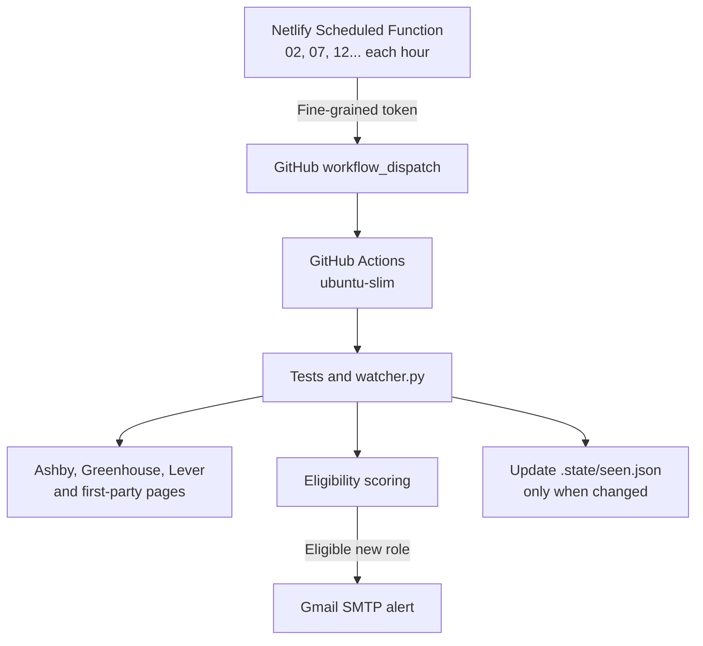

# AI Security Job Alert Agent

This private watcher checks selected first-party career sources every five minutes and emails Arunim only when a new or materially changed role passes the role, location and seniority gates.

## Production status

**Operational as of 3 November 2026.**

- Netlify is the primary five-minute scheduler.
- GitHub Actions runs the private scanner, tests, email delivery and deduplication-state updates.
- The Netlify function successfully dispatched the workflow manually and on two independent scheduled executions.
- Verified scheduled runs: [#9 at 5:22 PM IST](https://github.com/arunimshukla/ai-security-job-alert-agent/actions/runs/41630974701) and [#10 at 5:27 PM IST](https://github.com/arunimshukla/ai-security-job-alert-agent/actions/runs/41631639727).
- Recent production scans indexed 3,139 jobs with no source or email errors.
- `EXTERNAL_SCHEDULER_ENABLED=true` disables the redundant GitHub-native cron job while preserving Netlify dispatches and manual runs.
- The current fine-grained GitHub token expires on **3 November 2027**.

No email is expected when the workflow reports `"alerts": 0`. That is a successful scan with no newly eligible opening.

## Architecture

### What runs where

| Component | Responsibility | Credentials/data held |
|---|---|---|
| Netlify | Fires the schedule and calls GitHub's workflow-dispatch API | Only `GITHUB_ACTIONS_TOKEN` |
| GitHub Actions | Tests, scans sources, scores roles, sends email and persists deduplication state | Gmail secrets, configuration and private state |
| Public Netlify site | Serves a no-index `Not found` page | No jobs, findings or credentials |
| Job sources | Return public career listings | No credentials from this project |

The Netlify function does not scrape jobs. It normally completes in about 1–2 seconds. The heavier scan stays in the private repository, where GitHub Actions can use encrypted Gmail secrets and commit deduplication state.

### End-to-end execution

1. Netlify invokes `dispatch-job-watch` at minutes `02, 07, 12, 17, 22, 27, 32, 37, 42, 47, 52, 57`.
2. The function sends `POST /repos/arunimshukla/ai-security-job-alert-agent/actions/workflows/watch.yml/dispatches`.
3. GitHub records this as a `workflow_dispatch` event. The Actions UI labels it **Manually triggered** even though Netlify initiated it automatically.
4. The workflow serializes runs through the `job-watcher` concurrency group and checks out the latest `main` state.
5. Sixteen Python tests and four Node dispatcher tests run before the live scan.
6. `watcher.py` fetches the configured ATS APIs and first-party pages, applies hard eligibility rules and scores candidates.
7. A qualifying new or materially updated role triggers the Gmail alert.
8. `.state/seen.json` is committed only when it actually changes. Unchanged scans do not create state-churn commits.

## Why this split architecture

The first-mover requirement needs a dependable five-minute trigger. GitHub's native scheduled workflows are best-effort and can start late, so they are retained only as a disabled fallback. Netlify provides the clock; GitHub provides the private execution environment.

Vercel Hobby is unsuitable because its cron frequency is too limited. Moving the entire scanner to a continuously running host would add service cost and persistent-state administration without solving a current capacity problem: verified scans complete in under one minute.

## Authentication and secret boundary

### Netlify token

Create a [fine-grained GitHub token](https://github.com/settings/personal-access-tokens/new?name=Netlify%20Job%20Watcher&description=Dispatches%20the%20private%20job%20watcher&target_name=arunimshukla&expires_in=365&actions=write) with:

- Resource owner: `arunimshukla`
- Repository access: **Only select repositories**
- Selected repository: `ai-security-job-alert-agent`
- Repository permission: **Actions — Read and write**
- Metadata: read-only, added automatically by GitHub
- No Contents, Administration or account permissions

Paste the raw value beginning with `github_pat_` into Netlify's `GITHUB_ACTIONS_TOKEN`. Do not add quotes, spaces or the word `Bearer`.

### GitHub email secrets

Gmail requires two-step verification before it offers App Passwords. In **GitHub repository → Settings → Secrets and variables → Actions**, configure:

| Secret | Value |
|---|---|
| `SMTP_USERNAME` | Gmail address |
| `SMTP_PASSWORD` | 16-character Google App Password, without spaces |
| `ALERT_EMAIL_TO` | Destination address |
| `PROFILE_PROOF_POINTS` | Optional: up to three private proof points separated with `||` |

Gmail secrets stay in GitHub and are never copied to Netlify.

## Rebuild or rotate the scheduler

1. Create the fine-grained token using the restrictions above. GitHub's maximum preconfigured expiry is 365 days.
2. In Netlify, open the `idyllic-paprenjak-e47e48` project.
3. Open **Project configuration → Environment variables**.
4. Create or edit `GITHUB_ACTIONS_TOKEN`. The current project keeps the same secret value in Production, Deploy Previews, Branch deploys, and Preview Server & Agent Runners.
5. Save the variable.
6. **Trigger a new production deploy.** Existing deployed functions keep the old environment-variable snapshot until redeployed.
7. Open **Functions → dispatch-job-watch** and confirm:
   - the **Scheduled** badge is present;
   - the next execution time is visible;
   - the schedule is `2,7,12,17,22,27,32,37,42,47,52,57 * * * *`.
8. Click **Run now** once. The successful function log must contain:
   
       {"dispatched":true,"owner":"arunimshukla","repository":"ai-security-job-alert-agent","workflow":"watch.yml","ref":"main"}

9. Confirm that the resulting GitHub workflow finishes successfully.
10. Observe two automatic executions five minutes apart.
11. In **GitHub repository → Settings → Secrets and variables → Actions → Variables**, set `EXTERNAL_SCHEDULER_ENABLED=true`.

Do not set the external-scheduler variable until Netlify has passed the manual test and two scheduled tests. Leaving it unset keeps GitHub's native cron as a temporary fallback.

## Troubleshooting

| Symptom | Meaning | Resolution |
|---|---|---|
| `401 Bad credentials` | GitHub could not authenticate the token. This is not an Actions-permission error. | Generate a new fine-grained token, paste the raw `github_pat_` value into Netlify, save it and redeploy Production. Stop repeated retries until replaced. |
| `403` or `404` from workflow dispatch | The token authenticated but lacks repository access or Actions write permission. | Select only this repository and set **Actions → Read and write**. |
| `GITHUB_ACTIONS_TOKEN is not configured` | The Netlify variable is missing from the deployed function scope. | Add it to Functions/Production and redeploy. |
| Netlify still uses an old token | Environment-variable edits do not change an already deployed function. | Trigger a new production deploy, then run the function again. |
| Netlify says **Invalid state key** during login | The temporary OAuth login state expired. This does not affect the deployed scheduler. | Start a fresh login from `https://app.netlify.com/` and complete it promptly. |
| GitHub labels the run **Manually triggered** | Netlify uses GitHub's `workflow_dispatch` API. | Expected behavior; verify the Netlify timestamp and GitHub run time. |
| GitHub scheduled run is skipped | The external scheduler flag is `true`. | Expected behavior. Netlify and manual dispatches still run. |
| Workflow succeeds but no email arrives | No newly eligible role passed the filters. | Check the JSON summary. `alerts: 0` means no email should be sent. |
| A match exists but email fails | SMTP secrets or Gmail App Password are invalid. | Repair the GitHub secrets. The watcher leaves the match pending for the next run. |
| `source_errors` is non-empty | At least one monitored source failed. | Inspect the named source before trusting coverage. |
| Repeated or overlapping runs | More than one scheduler is active or manual tests are being repeated. | Keep `EXTERNAL_SCHEDULER_ENABLED=true`; the concurrency group will serialize any remaining overlap. |

### What caused the two-hour setup delay

The scanner itself was healthy. The failure was in the Netlify-to-GitHub authentication and deployment path:

1. The original prefilled token link requested 366 days, exceeding GitHub's 365-day limit.
2. Netlify held an invalid token, so GitHub correctly returned `401 Bad credentials`.
3. Token permissions were initially suspected, but insufficient permission would normally produce `403` or `404`; the `401` proved the credential itself was invalid.
4. Replacing the environment variable was not enough—the production function had to be redeployed to receive the new value.
5. A Netlify Google OAuth attempt expired with `Invalid state key` and had to be restarted from a fresh login.
6. The repair was not declared complete until one manual dispatch and two five-minute scheduled dispatches succeeded end to end.

## Test and operate the scanner

### Manual GitHub test

1. Open **Actions → Five-minute AI security job watcher → Run workflow**.
2. Leave **Send a synthetic test alert** off to perform a real scan.
3. Turn it on only when testing email delivery; it sends a synthetic alert and does not consume a real match.

### Local tests

    python -m unittest discover -s tests -v
    node --test tests/test_dispatch.mjs

### Expected monthly usage

Five-minute monitoring produces 288 scans per day, or about 8,640 scans in a 30-day month. Each GitHub job is rounded up to a billed minute. At the current `ubuntu-slim` rate and sub-minute runtime, the baseline is approximately **$17.28/month** before GitHub's included allowance.

The Netlify dispatcher is small, but check both providers' usage dashboards after the first week. Retries, duplicate schedulers or jobs exceeding one billed minute increase the estimate.

## What it monitors

- [Ashby](https://www.ashbyhq.com/), [Greenhouse](https://www.greenhouse.com/) and [Lever](https://www.lever.co/) public job-board APIs
- Selected first-party careers pages without one of those feeds
- Technical/product/solutions marketing, technical communications, content strategy and social/founder-brand roles
- AI, cybersecurity, developer-tooling and infrastructure companies
- Explicitly worldwide-remote roles as the highest location priority, followed by India and Delhi-NCR
- Strict exclusions for geography-restricted and people-management roles

The first run records a quiet baseline. Later runs alert only on unseen or materially changed jobs scoring at least 60/100 and passing the hard eligibility gates.

## Editing the search

- `config.json` contains companies, role phrases, location rules and the score threshold.
- `.state/seen.json` is generated automatically and prevents repeat alerts.
- `alerts.md` contains the latest run's alert summary.

To add a company, add an entry under `targets` using its public ATS board name. The watcher supports [Ashby](https://www.ashbyhq.com/) (`ashby`), [Greenhouse](https://www.greenhouse.com/) (`greenhouse`), [Lever](https://www.lever.co/) (`lever`) and first-party career pages (`html`).

The current first-party watchlist includes:

- [Arcanna.ai](https://arcanna.ai/)
- [Harmonic Security](https://www.harmonic.security/)
- [Sola Security](https://sola.security/)
- [Dropzone AI](https://www.dropzone.ai/)
- [Chainguard](https://www.chainguard.dev/)
- [Abnormal Security](https://abnormal.ai/)
- [SentinelOne](https://www.sentinelone.com/)
- [OpenAI](https://openai.com/)
- [Anthropic](https://www.anthropic.com/)
- [CloudSEK](https://www.cloudsek.com/)
- [JumpCloud](https://jumpcloud.com/)
- [Cyara](https://cyara.com/)
- [Kantiv](https://www.kantiv.com/)
- [OpenZeppelin](https://www.openzeppelin.com/)
- [Cloudflare](https://www.cloudflare.com/)
- [Canonical](https://canonical.com/)
- [Prophet Security](https://www.prophetsecurity.ai/)
- [HiddenLayer](https://www.hiddenlayer.com/)
- [Wiz](https://www.wiz.io/)
- [ElevenLabs](https://elevenlabs.io/)

Arcanna.ai is configured as verified worldwide-remote from its first-party careers policy. Its Technical Product Marketing Manager page is content-fingerprinted so a material page edit can trigger a new alert even when the title and URL do not change.

## Delivery resilience

If a matching job is found but SMTP delivery fails, it remains pending for the next run. A dry run also leaves matches pending. The workflow fails visibly when email delivery or any monitored source fails, instead of silently claiming full coverage.

Unchanged listings no longer rewrite `.state/seen.json`. This prevents a five-minute scan from creating thousands of meaningless Git commits and prevents those state-only commits from consuming Netlify production-deploy credits.
