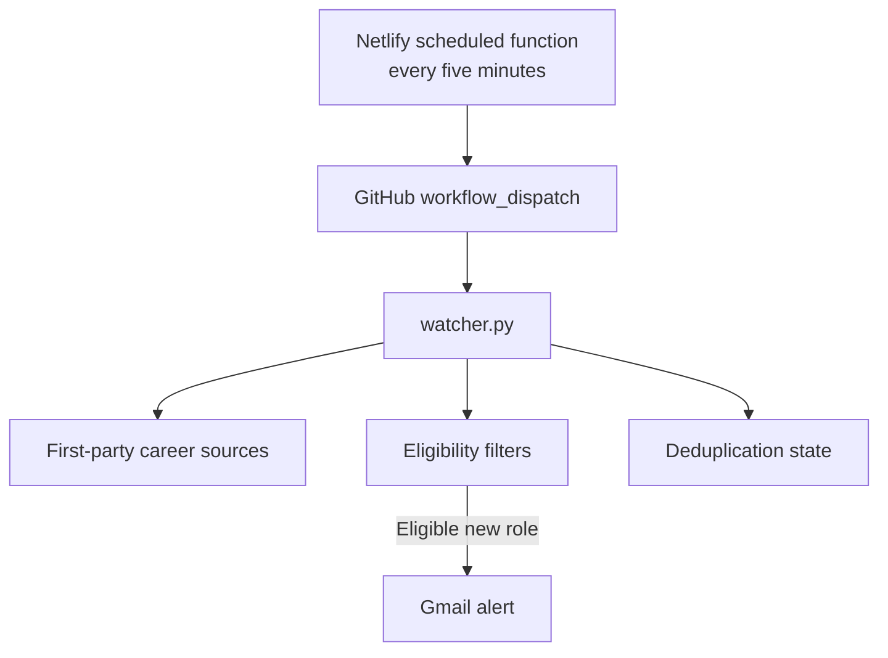

# AI-Cybersecurity Job Alert Agent

A five-minute personal monitor for individual-contributor marketing roles at companies whose product is built around AI security, agent security, autonomous security operations or AI-powered threat detection.

The agent is deliberately narrow. It does not monitor general AI companies, conventional infrastructure vendors, Web3 firms or generic SaaS companies.

## Target roles

- Technical Product Marketing Manager
- Security/Product Marketing Manager or Lead
- Technical or Security Marketing Manager
- Solutions or Developer Marketing
- Product/Technical Communications
- Technical Content Lead or Writer
- Developer Advocate or Developer Relations
- Content Strategy/Marketing
- Founder Brand or Social Media

Paid-media, field-marketing, demand-generation, SEO, sales, engineering and people-management roles are penalized or rejected.

## Monitored AI-cybersecurity companies

| Focus | Companies |
|---|---|
| AI SOC and autonomous security operations | [Arcanna.ai](https://arcanna.ai/), [Dropzone AI](https://www.dropzone.ai/), [Prophet Security](https://www.prophetsecurity.ai/), [Simbian](https://simbian.ai/) |
| AI/data/agent security | [Harmonic Security](https://www.harmonic.security/), [Sola Security](https://sola.security/), [Noma Security](https://noma.security/), [Zenity](https://zenity.io/), [Pillar Security](https://www.pillar.security/), [Straiker](https://www.straiker.ai/), [Enkrypt AI](https://www.enkryptai.com/), [WitnessAI](https://witness.ai/), [Keycard](https://www.keycard.ai/) |
| AI-native threat detection and offensive security | [Abnormal Security](https://abnormal.ai/), [SentinelOne](https://www.sentinelone.com/), [CloudSEK](https://www.cloudsek.com/), [HiddenLayer](https://www.hiddenlayer.com/), [XBOW](https://xbow.com/), [Cracken](https://cracken.ai/) |

The configuration uses first-party Ashby, Greenhouse and career-page sources only. Edit [`config.json`](config.json) to change the universe.

## Email decision

A listing produces an email only when every condition below is satisfied:

1. The posting has never been seen before, or a posting previously recorded as ineligible has become eligible.
2. Its title matches one of the target role families.
3. Its score is at least 65/100.
4. It explicitly permits India/Delhi-NCR or worldwide work.
5. It is not explicitly part-time, an internship, freelance, temporary or a contract role.
6. It has no people-management requirement or blocked leadership title.
7. Its application deadline has not passed.
8. If structured compensation is published, the maximum is at least USD 65,000 or INR 30,00,000.

Unpublished compensation and employment type are marked for verification instead of being silently treated as confirmed. Geography remains strict: a listing that merely says “Remote” is not emailed unless India or worldwide eligibility is explicit.

The first execution creates a quiet baseline. Later executions email only genuinely unseen roles or roles that cross from ineligible to eligible. Ordinary listing edits and internal fingerprint-format changes are recorded silently and cannot re-alert an old role. Failed email delivery leaves a genuine match pending so the next run retries it.

## Minimal architecture



- **Netlify** is the only production scheduler. It sends one authenticated GitHub workflow-dispatch request and does not scrape jobs.
- **GitHub Actions** runs the scanner, sends email and persists deduplication state.
- **GitHub change-only CI** runs Python and Node tests when code or configuration changes; tests do not run on every five-minute scan.

The watcher workflow has no independent cron schedule. This prevents duplicate schedulers and removes the unused `EXTERNAL_SCHEDULER_ENABLED` branch.

## Repository files

| File | Purpose |
|---|---|
| `config.json` | Curated companies, roles, location rules, salary floors and scoring |
| `watcher.py` | ATS collection, eligibility, email and state handling |
| `.state/seen.json` | Deduplication fingerprints |
| `.github/workflows/watch.yml` | Netlify-dispatched production scan |
| `.github/workflows/quality.yml` | Change-only tests |
| `netlify/functions/dispatch-job-watch.mjs` | Five-minute dispatcher |

## Required GitHub secrets

| Secret | Purpose |
|---|---|
| `SMTP_USERNAME` | Gmail sender |
| `SMTP_PASSWORD` | Gmail App Password |
| `ALERT_EMAIL_TO` | Alert destination |
| `PROFILE_PROOF_POINTS` | Optional private application proof points separated with `||` |

Netlify requires only `GITHUB_ACTIONS_TOKEN`, restricted to this repository with Actions read/write permission.

## Test

```bash
python -m unittest discover -s tests -v
node --test tests/test_dispatch.mjs
```

For a real manual scan, open **Actions → Five-minute AI security job watcher → Run workflow**. Enable the synthetic-alert input only when testing email delivery.

## Cost controls

- Five-minute monitoring produces about 8,640 scans in a 30-day month.
- Standard GitHub-hosted runners are free while this repository is public.
- The GitHub account has an Actions budget of $0 with paid usage blocked.
- Netlify Free has a 300-credit monthly hard limit; the lightweight dispatcher consumes only a small fraction of it.
- Netlify deploys only when `netlify/**` or `netlify.toml` changes.
- Unchanged job state does not create commits.
- Runs are serialized and limited to four minutes.

## Failure semantics

- `alerts: 0`: successful scan, no new eligible role.
- `source_errors` non-empty: at least one monitored source failed; the workflow fails visibly.
- Eligible match plus `email_sent: false`: Gmail failed; the workflow fails and retries the match next time.
- GitHub shows “Manually triggered”: expected for Netlify API dispatches.
